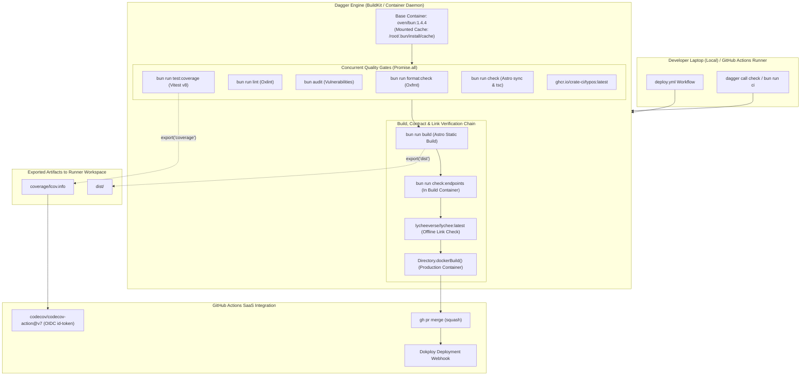

# Architecture Design: Dagger CI Consolidation & Main Rebase Conflict Resolution

- **Document Revision**: 1.1.0
- **Status**: Reviewed & Implementation-Ready (Awaiting Human Approval)
- **Target File**: `docs/design/dagger-ci-conflict-resolution.md`
- **Owner**: `Fluidise/site` Maintainers
- **Context**: Resolving merge conflicts between `origin/main` (#38–#43) and `ci/dagger-pipeline` (#44)

---

## 1. Problem Statement & Conflict Analysis

### 1.1 Context

In PR #44 (`ci/dagger-pipeline`), Dagger was introduced via a dedicated TypeScript module (`.dagger/src/index.ts`) and GitHub Actions runner (`dagger/dagger-for-github@v8.4.1`) to eliminate vendor lock-in, enable local-to-CI parity, and run checks concurrently.

Simultaneously, `origin/main` absorbed PRs #38 through #43, introducing critical quality and security gates:

1. **Dependency Audit**: `bun audit` to detect CVEs in lockfiles.
2. **Code Coverage Engine**: `@vitest/coverage-v8` running `vitest run --coverage`, producing `coverage/lcov.info`.
3. **Codecov Reporting**: `codecov/codecov-action@v7` using OIDC (`id-token: write`).
4. **Machine Endpoint Contract Verification**: `bun run check:endpoints` (`src/tests/verify-endpoints.ts`) validating `/llms.txt`, `/llms-full.txt`, `/manifesto.md`, and `/tools.json`.
5. **Spell Checking**: `crate-ci/typos@master` linting typos across the repository.
6. **Internal Link Integrity**: `lycheeverse/lychee-action@v2` performing offline checking of all static HTML and discovery files in `dist/`.
7. **Hardened Auto-merge Error Handling**: Graceful fallback when GitHub Actions tokens lack workflow-mutation permissions.

### 1.2 The Conflict

When attempting to merge `ci/dagger-pipeline` into `main`, GitHub reports `mergeable: CONFLICTING` (`DIRTY`). Both branches modified `.github/workflows/deploy.yml` and `package.json` at identical insertion points.

Beyond raw text collisions, there is an **architectural boundary conflict**:

- Should Dagger absorb the newly introduced verification steps (`bun audit`, `check:endpoints`, `test:coverage`, `typos`, `lychee`), or should GitHub Actions maintain an outer shell around Dagger?
- How should artifact-dependent steps (Codecov upload requiring `coverage/lcov.info`, Lychee link checking requiring `dist/`) receive build outputs from the Dagger engine without broken mounts?

---

## 2. Invariants & Architectural Constraints

1. **Parity Invariant (True Local/CI Parity)**:
   Any validation gate enforceable in CI must be runnable locally with identical semantics via `dagger call check` or `bun run ci`, without requiring special CI environment variables or host tool installations (e.g., `typos` and `lychee` run in containerized OCI steps).
2. **Zero Regression Invariant**:
   All 7 quality/security gates introduced in `origin/main` (#38–#43) must remain strictly enforced. No test, audit, endpoint verification, spellcheck, or link check may be relaxed or omitted.
3. **Deterministic Artifact Export Contract**:
   Dagger executes within container isolation. Artifacts required by host SaaS actions (specifically `coverage/lcov.info` for `codecov/codecov-action@v7`) must be deterministically exported to the host filesystem via Dagger's `Directory.export()` API.
4. **Security & Least-Privilege Invariant**:
   Tokens and credentials (OIDC `id-token`, `GITHUB_TOKEN`, Dokploy webhook secrets) must never be passed into container environments where they are not required. SaaS publication actions (Codecov, Dokploy) stay on the GitHub Actions host.
5. **Context Hygiene & Cache Invariant**:
   Generated output folders (`coverage`, `dist`, `.astro`, `node_modules`) must be excluded from Dagger constructor source loading and `.dockerignore` to prevent Docker cache busting.

---

## 3. Architectural Decision Frontier & Trade-offs

### Decision 1: Domain Boundary between Dagger and GitHub Actions

| Approach                                                                        | Architecture                                                                                                                                                                                                                             | Trade-offs                                                                                                                                                                                                                                                                                                                          | Recommendation          |
| :------------------------------------------------------------------------------ | :--------------------------------------------------------------------------------------------------------------------------------------------------------------------------------------------------------------------------------------- | :---------------------------------------------------------------------------------------------------------------------------------------------------------------------------------------------------------------------------------------------------------------------------------------------------------------------------------- | :---------------------- |
| **Option A: Full Dagger Orchestration with SaaS Companion Steps (Recommended)** | **Dagger** orchestrates all build, test, audit, lint, spellcheck, endpoint, link check, and Docker builds via containers.<br>**GitHub Actions** only manages repository checkouts, OIDC Codecov upload, auto-merge, and Dokploy webhook. | **Pros:** 100% local-to-CI parity. Developers run `bun run ci` and get exact same checks without installing `typos` or `lychee` locally. Clean separation: code/quality in Dagger, SaaS secrets/webhooks in GHA.<br>**Cons:** First run pulls `ghcr.io/crate-ci/typos` and `lycheeverse/lychee` images (cached on subsequent runs). | **Adopt (Recommended)** |
| **Option B: Hybrid Runner Split**                                               | Dagger runs only Bun steps; GHA runs `crate-ci/typos` and `lycheeverse/lychee-action`.                                                                                                                                                   | **Pros:** Slightly smaller Dagger file.<br>**Cons:** Breaks Parity Invariant (spelling/link checks fail in CI but pass locally).                                                                                                                                                                                                    | Reject                  |
| **Option C: Revert Dagger**                                                     | Drop Dagger and restore monolithic YAML.                                                                                                                                                                                                 | **Pros:** Zero container engine.<br>**Cons:** Loses all Dagger caching, concurrency, and local testability.                                                                                                                                                                                                                         | Reject                  |

### Decision 2: Artifact Export Mechanism

To provide `./coverage/lcov.info` to `codecov/codecov-action@v7`:

- In Dagger, `coverageDir.export("coverage")` is invoked directly during the `check()` pipeline execution if `exportArtifacts: true` (default in CI).
- In Dagger, `distDir.export("dist")` is also available and invoked when export is enabled.
- Host GHA runner executes `codecov/codecov-action@v7` against the exported `./coverage/lcov.info`.

---

## 4. Target Architecture



---

## 5. Contract Specifications

### 5.1 Approved File Write Boundaries

| File Path (Repository-Relative)                | Action                   | Owner / Purpose                                                                                                    |
| :--------------------------------------------- | :----------------------- | :----------------------------------------------------------------------------------------------------------------- |
| `docs/design/dagger-ci-conflict-resolution.md` | **Create**               | Canonical architectural design specification.                                                                      |
| `.dagger/src/index.ts`                         | **Modify**               | Implementation of Dagger pipeline with coverage export, typos, lychee, audit, and endpoint checks.                 |
| `.github/workflows/deploy.yml`                 | **Modify**               | Runner orchestration: Dagger call followed by Codecov OIDC upload, auto-merge, and Dokploy webhook.                |
| `package.json`                                 | **Modify**               | Merge scripts (`check:endpoints`, `lint:spelling`, `lint:links`, `test:coverage`, `ci`) and `@vitest/coverage-v8`. |
| `bun.lock`                                     | **Modify**               | Lockfile synchronized with `package.json` dependencies.                                                            |
| `.dockerignore`                                | **Modify**               | Add `coverage/` and `.dagger/` to prevent Docker context leakage.                                                  |
| `src/tests/verify-endpoints.ts`                | **Preserve (Read-Only)** | Upstream contract testing script from PR #41.                                                                      |
| `lychee.toml`                                  | **Preserve (Read-Only)** | Lychee configuration from PR #41.                                                                                  |

### 5.2 Dagger TypeScript Module (`.dagger/src/index.ts`)

```typescript
import { dag, Container, Directory, object, func, argument } from '@dagger.io/dagger';

@object()
export class FluidiseSite {
  source: Directory;

  constructor(
    @argument({
      defaultPath: '/',
      ignore: [
        'node_modules',
        '.git',
        'dist',
        'coverage',
        '.astro',
        '.dagger',
        '.worktrees',
        '.agents',
        '.gemini',
      ],
    })
    source: Directory,
  ) {
    this.source = source;
  }

  @func()
  buildEnv(): Container {
    return dag
      .container()
      .from('oven/bun:1.4.4')
      .withMountedCache('/root/.bun/install/cache', dag.cacheVolume('bun-cache'))
      .withDirectory('/app', this.source)
      .withWorkdir('/app')
      .withEnvVariable('ASTRO_TELEMETRY_DISABLED', '1')
      .withExec(['bun', 'install', '--frozen-lockfile']);
  }

  @func()
  async format(): Promise<string> {
    await this.buildEnv().withExec(['bun', 'run', 'format:check']).sync();
    return '✅ Code formatting is clean';
  }

  @func()
  async lint(): Promise<string> {
    await this.buildEnv().withExec(['bun', 'run', 'lint']).sync();
    return '✅ Oxlint passed without errors';
  }

  @func()
  async audit(): Promise<string> {
    await this.buildEnv().withExec(['bun', 'audit']).sync();
    return '✅ Dependencies audited with zero vulnerabilities';
  }

  @func()
  async typos(): Promise<string> {
    await dag
      .container()
      .from('ghcr.io/crate-ci/typos:latest')
      .withDirectory('/work', this.source)
      .withWorkdir('/work')
      .withExec(['typos'])
      .sync();
    return '✅ Spelling check passed';
  }

  @func()
  async test(): Promise<string> {
    await this.buildEnv().withExec(['bun', 'run', 'test:coverage']).sync();
    return '✅ Unit tests and coverage completed';
  }

  @func()
  async typecheck(): Promise<string> {
    await this.buildEnv().withExec(['bun', 'run', 'check']).sync();
    return '✅ Type check passed';
  }

  @func()
  build(): Directory {
    return this.buildEnv().withExec(['bun', 'run', 'build']).directory('/app/dist');
  }

  @func()
  async checkEndpoints(): Promise<string> {
    await this.buildEnv()
      .withExec(['bun', 'run', 'build'])
      .withExec(['bun', 'run', 'check:endpoints'])
      .sync();
    return '✅ Machine endpoints verified against schemas';
  }

  @func()
  async links(): Promise<string> {
    const dist = this.build();
    await dag
      .container()
      .from('lycheeverse/lychee:latest')
      .withDirectory('/work', this.source)
      .withDirectory('/work/dist', dist)
      .withWorkdir('/work')
      .withExec([
        'lychee',
        '--offline',
        '--config',
        'lychee.toml',
        'dist/**/*.html',
        'dist/llms.txt',
        'dist/llms-full.txt',
        'dist/tools.json',
        'dist/manifesto.md',
      ])
      .sync();
    return '✅ Link integrity verified with Lychee';
  }

  @func()
  async buildDocker(): Promise<string> {
    await this.source.dockerBuild().sync();
    return '✅ Production Docker image built successfully';
  }

  /**
   * Complete CI suite: concurrent format, lint, audit, test:coverage, typecheck, typos;
   * then static build, machine endpoints check, link check, and Docker container verification.
   * Exports coverage/ and dist/ to host when exportArtifacts is true.
   */
  @func()
  async check(exportArtifacts = true): Promise<string> {
    const env = this.buildEnv();

    // 1. Parallel static and unit checks
    const [testCtr] = await Promise.all([
      env.withExec(['bun', 'run', 'test:coverage']).sync(),
      env.withExec(['bun', 'run', 'format:check']).sync(),
      env.withExec(['bun', 'run', 'lint']).sync(),
      env.withExec(['bun', 'audit']).sync(),
      env.withExec(['bun', 'run', 'check']).sync(),
      dag
        .container()
        .from('ghcr.io/crate-ci/typos:latest')
        .withDirectory('/work', this.source)
        .withWorkdir('/work')
        .withExec(['typos'])
        .sync(),
    ]);

    // 2. Sequential build and dependent verification
    const builtEnv = await env.withExec(['bun', 'run', 'build']).sync();
    await builtEnv.withExec(['bun', 'run', 'check:endpoints']).sync();

    // 3. Link check on generated dist
    const distDir = builtEnv.directory('/app/dist');
    await dag
      .container()
      .from('lycheeverse/lychee:latest')
      .withDirectory('/work', this.source)
      .withDirectory('/work/dist', distDir)
      .withWorkdir('/work')
      .withExec([
        'lychee',
        '--offline',
        '--config',
        'lychee.toml',
        'dist/**/*.html',
        'dist/llms.txt',
        'dist/llms-full.txt',
        'dist/tools.json',
        'dist/manifesto.md',
      ])
      .sync();

    // 4. Export artifacts to host for Codecov and external inspection
    if (exportArtifacts) {
      await testCtr.directory('/app/coverage').export('coverage');
      await distDir.export('dist');
    }

    // 5. Docker container verification
    await this.source.dockerBuild().sync();

    return '🎉 All checks, tests, coverage, links, and Docker builds passed successfully!';
  }
}
```

### 5.3 GitHub Actions Workflow (`.github/workflows/deploy.yml`)

```yaml
name: CI/CD Pipeline

on:
  pull_request:
    branches: [main, 'feat/**']
    types: [opened, synchronize, reopened, ready_for_review]
  push:
    branches: [main]
  workflow_dispatch:

permissions:
  contents: read

concurrency:
  group: ci-${{ github.event.pull_request.number || github.ref }}
  cancel-in-progress: true

jobs:
  check:
    name: Validation, tests et build Docker
    if: github.event_name != 'pull_request' || !github.event.pull_request.draft
    runs-on: ubuntu-latest
    timeout-minutes: 15
    permissions:
      contents: read
      id-token: write
    steps:
      - name: Checkout repository
        uses: actions/checkout@v7
        with:
          persist-credentials: false

      - name: Validate PR title (Conventional Commits)
        if: github.event_name == 'pull_request'
        env:
          PR_TITLE: ${{ github.event.pull_request.title }}
        run: |
          CONVENTIONAL_REGEX="^(feat|fix|docs|style|refactor|perf|test|build|ci|chore|revert)(\([a-zA-Z0-9_.-]+\))?!?: .+"
          if ! echo "$PR_TITLE" | grep -qE "$CONVENTIONAL_REGEX"; then
            echo "❌ PR title does not follow Conventional Commits format:" >&2
            echo "   '$PR_TITLE'" >&2
            echo "Expected: <type>(<scope>): <description> (e.g. docs(brand): add logo assets)" >&2
            exit 1
          fi
          echo "✅ PR title follows Conventional Commits: '$PR_TITLE'"

      - name: Run CI pipeline with Dagger
        uses: dagger/dagger-for-github@v8.4.1
        with:
          version: '0.21.11'
          verb: call
          args: check --export-artifacts=true
        env:
          DAGGER_CLOUD_TOKEN: ${{ secrets.DAGGER_CLOUD_TOKEN }}

      - name: Upload coverage reports to Codecov
        uses: codecov/codecov-action@v7
        with:
          token: ${{ secrets.CODECOV_TOKEN }}
          files: ./coverage/lcov.info
          fail_ci_if_error: false
          verbose: false

  auto-merge:
    name: Auto-merge PR
    needs: [check]
    if: github.event_name == 'pull_request' && !github.event.pull_request.draft
    runs-on: ubuntu-latest
    permissions:
      contents: write
      pull-requests: write
    outputs:
      merged: ${{ steps.merge.outputs.merged }}
    steps:
      - name: Merge pull request
        id: merge
        env:
          GH_TOKEN: ${{ secrets.GITHUB_TOKEN }}
          PR_URL: ${{ github.event.pull_request.html_url }}
        run: |
          if gh pr merge "$PR_URL" --squash --delete-branch; then
            echo "merged=true" >> "$GITHUB_OUTPUT"
          else
            echo "::warning::Automatic squash-merge could not be performed by GITHUB_TOKEN (typically because workflow files were modified, which requires administrator privileges). Please merge manually."
            echo "merged=false" >> "$GITHUB_OUTPUT"
          fi

  deploy:
    name: Déploiement en production via Dokploy
    needs: [check, auto-merge]
    # ... Dokploy webhook remains identical to main
```

---

## 6. Migration, Rebase & Rollback Strategy

### 6.1 Safe Rebase Sequence

1. Fetch latest remote state:
   ```bash
   git fetch origin
   ```
2. Rebase `ci/dagger-pipeline` on `origin/main`:
   ```bash
   git rebase origin/main
   ```
3. Resolve conflict in `package.json`: Keep both `"ci": "dagger call check"` and all new upstream scripts + dependencies. Run `bun install` to update `bun.lock`.
4. Resolve conflict in `.github/workflows/deploy.yml`: Apply the simplified workflow structure above.
5. Update `.dagger/src/index.ts` with all expanded functions (`audit`, `typos`, `links`, `checkEndpoints`, and `export`).
6. Update `.dockerignore` to add `coverage/` and `.dagger/`.
7. Local verification:
   ```bash
   dagger call check
   bun run check
   bun run build
   ```
8. Push resolved branch with lease:
   ```bash
   git push --force-with-lease origin ci/dagger-pipeline
   ```

### 6.2 Rollback Procedure

If the Dagger engine fails on GitHub Actions runners (e.g., container provisioning timeout or Dagger registry unavailability):

1. **Emergency Reversion**: Revert `.github/workflows/deploy.yml` to the sequential Bun steps from `main` commit `3272707`.
2. **Persistence**: The `.dagger/` directory and local npm script `"ci"` remain harmlessly in the repository for local developer use without affecting the production CI path.

---

## 7. Compact Review State

- **Current Revision**: `1.1.0`
- **Reviewed Scope**: CI/CD conflict resolution, Dagger TypeScript module expansion, and GitHub Actions orchestration contract.
- **Coverage**:
  - Independent architectural review performed by `egm-design-critic` (`5fa7fac1-d378-4ef4-b592-466a79ebd404`).
  - Addressed Blocker 1 (Artifact Export): Replaced invalid input `@argument` with explicit `Directory.export()` inside Dagger.
  - Addressed Major 2 (Local Parity): Incorporated containerized `typos` and `lychee` directly into Dagger, achieving true 100% parity.
  - Addressed Major 3 (Write Boundary): Added formal Table in Section 5.1.
  - Addressed Major 4 (Container Lifecycle): Sequenced `checkEndpoints()` and `links()` on built container state.
  - Addressed Major 5 (Cache Busting): Added `coverage/` and `.dagger/` to ignore list and `.dockerignore`.
  - Addressed Major 6 (Rollback Strategy): Documented explicit emergency rollback plan.
  - Addressed Nit 7: Aligned method naming to `check()`.
- **Pending Human Approval**: Final human sign-off on Revision `1.1.0` prior to leaving design workflow and proceeding to execution.
